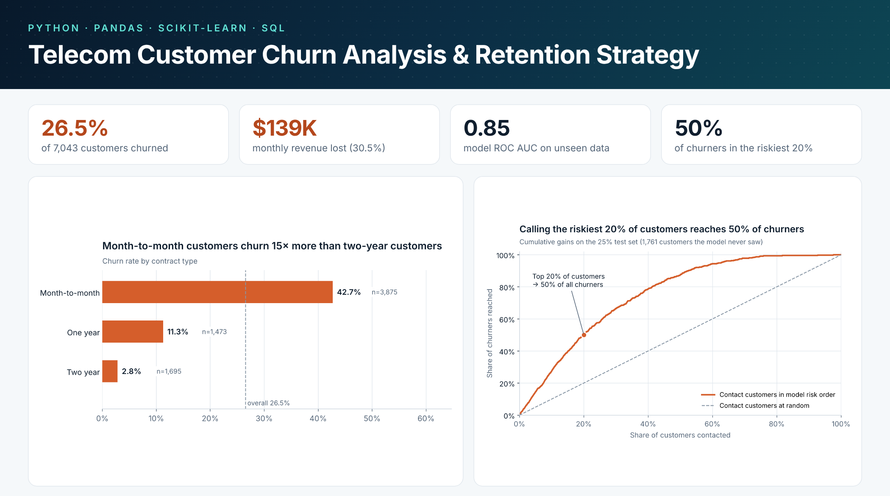
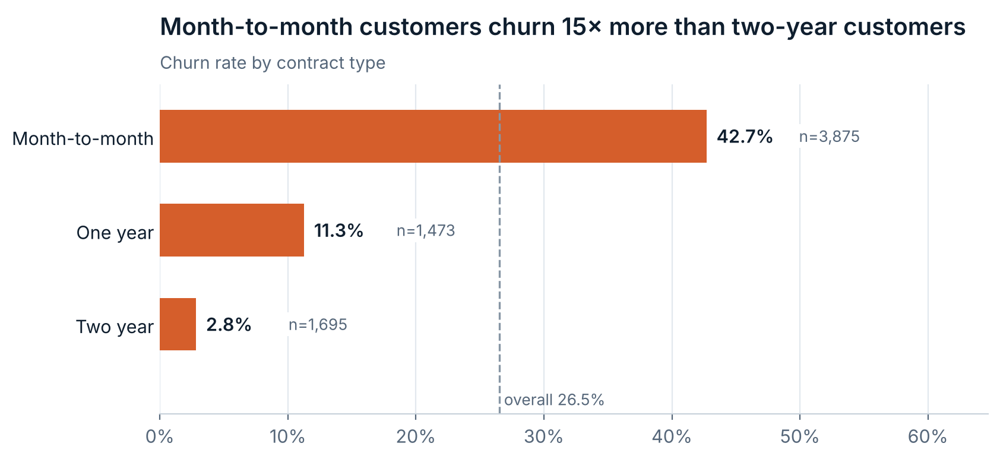
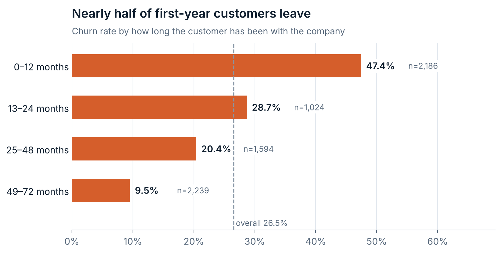
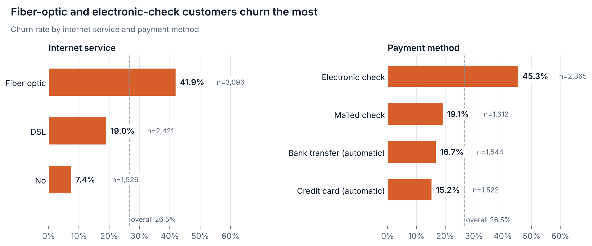
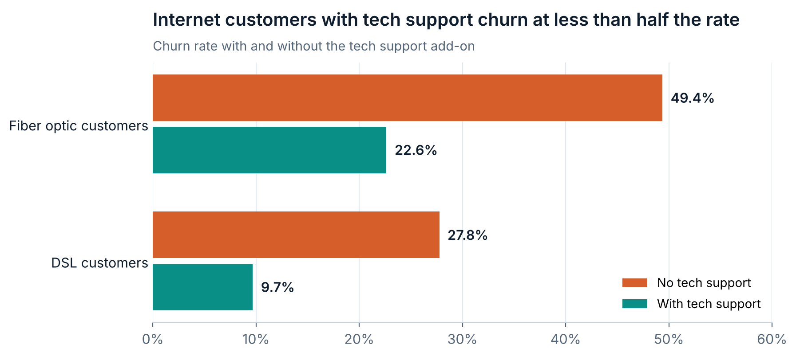
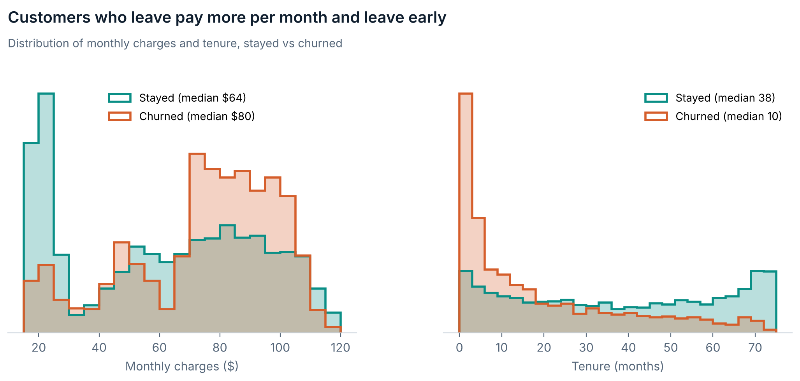
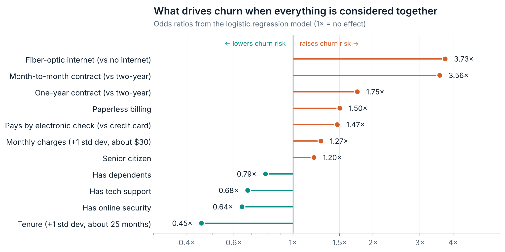
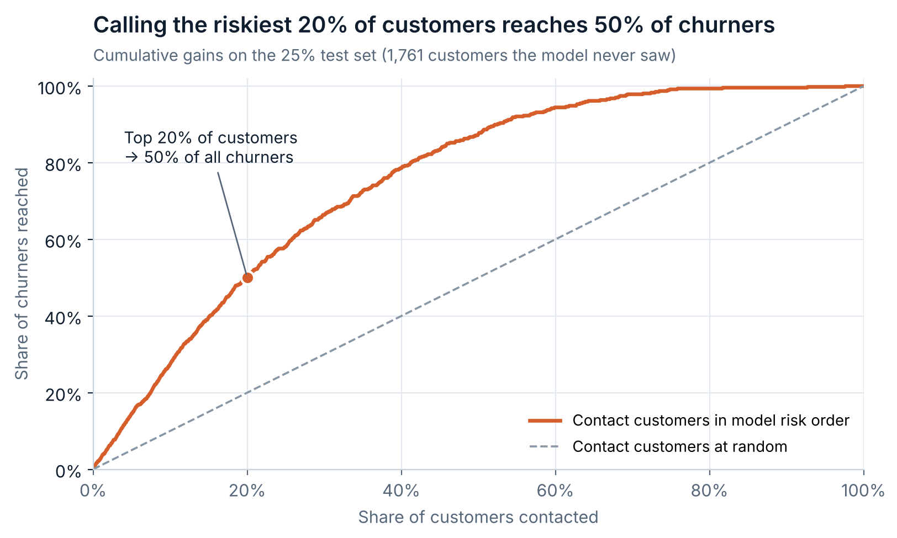

# Telecom Customer Churn Analysis & Retention Strategy



Python analysis of why customers leave a telecom provider, how much revenue it costs, and which customers the retention team should contact first.

**Tools:** Python (pandas, matplotlib, scikit-learn), SQL (SQLite), Jupyter Notebook

## Project Overview

A telecom provider is losing customers every month, and each one takes their monthly revenue with them. Using 7,043 customer records, this project:

- measures churn and the monthly recurring revenue (MRR) lost to it
- finds which customer groups churn most, with SQL and pandas
- builds a logistic regression model that scores every customer's churn risk
- turns the findings into six retention recommendations

The full, step-by-step analysis is in [`notebooks/telecom_churn_analysis.ipynb`](notebooks/telecom_churn_analysis.ipynb).

## Key Questions

1. How many customers churn, and how much monthly revenue is lost?
2. Which groups churn most (contract, tenure, internet service, payment method, support services)?
3. Which factors still matter once everything is considered together?
4. Can customers be ranked by risk so the retention team targets the right people?
5. What should the business do?

## Key Findings

| Finding | Number |
|---|---|
| Overall churn rate | **26.5%** (1,869 of 7,043 customers) |
| Monthly revenue lost to churn | **$139,131**, 30.5% of MRR (about $1.67M a year) |
| Share of lost revenue from month-to-month customers | **86.9%** |
| Churn: month-to-month vs two-year contract | **42.7% vs 2.8%** |
| Churn in the first 12 months | **47.4%** |
| Churn: fiber-optic customers | **41.9%** |
| Churn: electronic-check payers vs automatic payments | **45.3% vs 15–17%** |
| Fiber customers: no tech support vs with tech support | **49.4% vs 22.6%** |

### Contract type is the clearest divide


### The first year is the danger zone


### Fiber-optic and electronic-check customers churn the most


### Support add-ons are linked to much lower churn


### Customers who leave pay more and leave early


## Churn Risk Model

A **logistic regression** model was trained on 75% of customers and tested on the remaining 25% (1,761 customers it never saw). It was chosen over a random forest because it scored the same and is far easier to explain.

| Metric (test set) | Result |
|---|---|
| ROC AUC | **0.845** (random forest: 0.844) |
| Accuracy | 80.0% |
| Precision / recall at 0.5 cut-off | 64.5% / 54.4% |
| Churners found in the riskiest 20% of customers | **50%** |
| Cross-validated AUC, all customers | 0.843 |

### What drives churn, all else equal


### Who to call first


Every customer gets a cross-validated risk score and tier in [`data/customer_risk_scores.csv`](data/customer_risk_scores.csv). In the **High** tier (top 20%), 67.6% of customers actually churned, and the tier holds $115,981 of monthly revenue.

## Recommendations

1. **Move month-to-month customers onto contracts.** Offer a discount or perk for switching to a one-year contract, starting with high-risk month-to-month customers (3.6× the churn odds of two-year customers).
2. **Fix the first year.** Run structured onboarding: a welcome call, check-ins at months 1, 3 and 6, and fast resolution of early problems (47.4% first-year churn).
3. **Investigate the fiber-optic service.** Review pricing, reliability and competitor offers. Fiber customers pay the most but churn at 41.9%.
4. **Bundle tech support and online security.** Offer new internet customers a free trial, and A/B test whether it reduces churn.
5. **Move electronic-check payers to automatic payment** with a small incentive (45.3% vs 15–17% churn).
6. **Run the risk model monthly** and give the retention team the high-risk list.

## Data Limitations

- IBM's sample data describes a fictional company, so the patterns are realistic but are not industry benchmarks.
- It is a single snapshot (churn in one month), with no history or seasonality.
- The findings are associations, not proof of cause, so retention offers should be tested before full rollout.
- There is no cost data, so the return on each recommendation cannot be calculated yet.

## Files Included

- `notebooks/telecom_churn_analysis.ipynb`: full analysis with code, charts and explanations
- `sql/churn_analysis_queries.sql`: SQL versions of the key queries
- `data/Telco-Customer-Churn.csv`: original dataset
- `data/telco_churn_clean.csv`: cleaned data, ready for Power BI or Excel
- `data/customer_risk_scores.csv`: churn risk score and tier for every customer
- `images/`: all charts
- `case-study/`: short written case study (PDF)

## How to Run

```bash
pip install -r requirements.txt
jupyter notebook notebooks/telecom_churn_analysis.ipynb
```

## Data Source

IBM **Telco Customer Churn** sample dataset, from [IBM/telco-customer-churn-on-icp4d](https://github.com/IBM/telco-customer-churn-on-icp4d), licensed under the Apache License 2.0.
